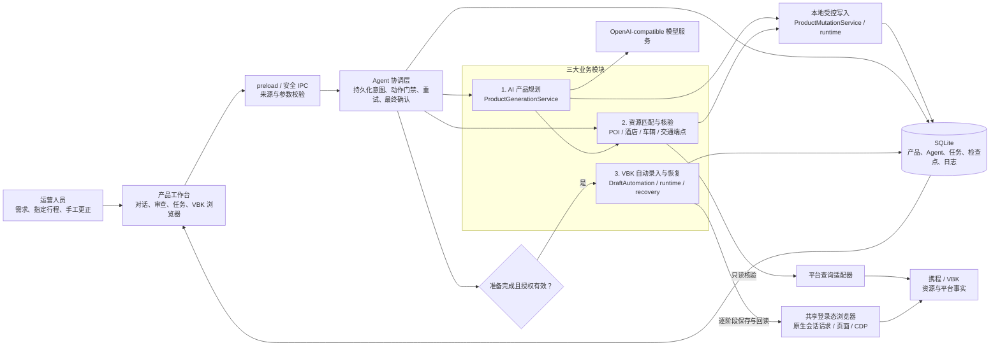
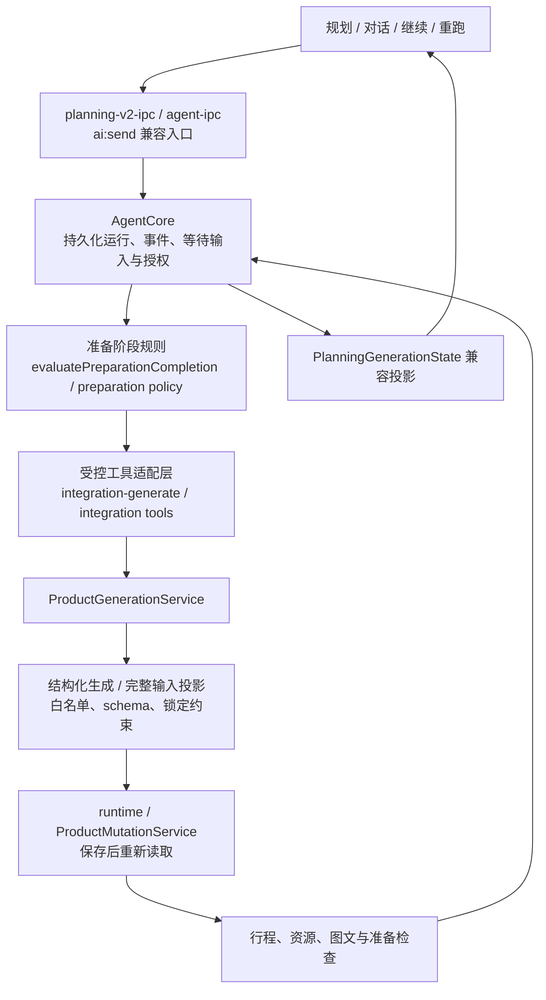
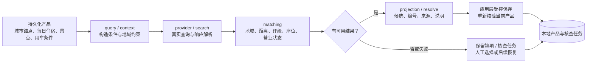
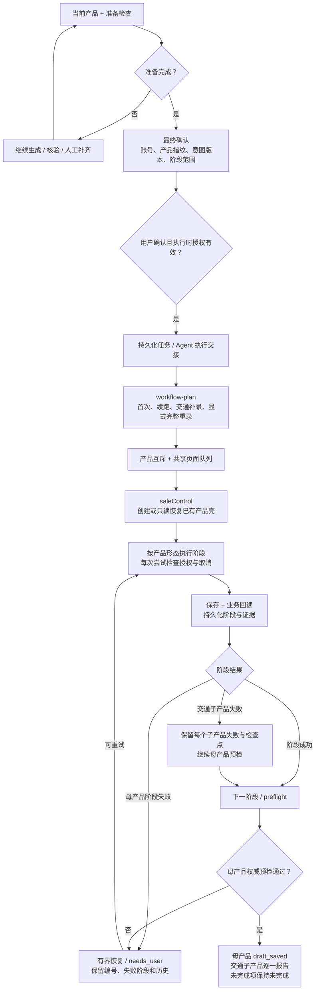

# VBK Desktop 架构（当前工作区）

> 核验日期：2026-10-11。描述当前源码，包括尚未提交的重构；不代表已安装版本或生产版本。
> 产品目标见 `PRODUCT.md`，交互见 `DESIGN.md`。历史问题逐项核验见 [架构问题核验](docs/architecture-audit-2026-10-11.md)。

## 1. 三个核心业务模块

| 模块 | 负责什么 | 产出与结束条件 |
| --- | --- | --- |
| AI 产品规划 | 理解需求，保留指定行程，生成结构化产品，组织补齐与人工确认 | 本地产品通过准备检查，可以请求最终录入授权 |
| 资源匹配与核验 | 查询并匹配真实 POI、每日酒店、酒店资源库、车辆和交通端点 | 已核验候选/编号或明确缺项；写入本地产品 |
| VBK 自动录入与恢复 | 按授权范围确定性保存草稿、逐阶段回读、有界重试与续跑 | 母产品预检通过；交通子产品分别报告最终回读结果 |

Agent 是跨模块协调层；SQLite、产品写入服务和登录态浏览器是共享底座。
规划会调用资源核验，资源结果也可能促使规划修正，因此前三段不是一次性的直线流水线。



## 2. 正式入口与内部边界



- `main-ipc.ts` 注册 `registerPlanningV2Ipc`。`planning:start/resume` 等转为 Agent 意图；`ai:send/cancel` 同样委托 Agent。
- 旧 `planning-ipc` / `plan-orchestrator` 实现仍在仓库中，但不是当前正式注册的规划入口。
- `ProductGenerationService` 负责生成、受控写入、确定性补全、资源衔接及保存后验证；Agent 负责调度、重试预算、人工输入和授权。
- 完整指定行程优先投影；图文和商业生成失败可以使用既有确定性补全，其它生成错误继续报告。
- RFC6902 `patch_product` 与模块生成协议仍共存，但位于同一 Agent 调度体系。字段级副标题生成仍有独立调用。
- `planning-state-projection.ts` 只转换进度，不伪造 accepted 模块，也不决定产品是否就绪。

详细职责见 [AI 产品规划](docs/ai-product-planning.md)。

## 3. 资源核验边界



| 资源域 | 稳定入口 | 职责 |
| --- | --- | --- |
| 行程 POI | `planning/poi-enrichment.ts` | 行程遍历、地域消歧、营业核验、编号回填和核查任务 |
| 每日酒店 | `infrastructure/ctrip-hotel-search.ts` | 逐晚住宿地标、距离和评级匹配、许可内重试、进度回填 |
| VBK 酒店资源库 | `operations/hotel-resource.ts` | 平台资源库查询与匹配，和每日携程酒店候选分开 |
| 车辆资源组 | `operations/vehicle-resource.ts` | 预算及座位匹配、正常无结果时兜底、结果构建 |
| 大交通端点 | Agent 集成与交通查询适配器 | 准备阶段核验站点；正式资源及班期以子产品执行回读为准 |

候选查询不等于平台绑定。网络、登录和解析异常不能伪装成正常无候选；未核验编号不能由模型补造。
酒店降档必须读取应用层计算的逐日许可；策略默认值不等于任意日期或范围的授权。
详细契约见 [资源匹配与核验](docs/resource-matching-verification.md)。

## 4. 授权录入与恢复



实际阶段顺序由 `draftPhasesFor` 决定，销售控制在进入阶段列表前创建或恢复产品壳：

```text
saleControl → basic → presentation → itinerary → package
  → [pricingInventory] → [hotelResource] → [vehicleResource]
  → terms → [trafficLine] → preflight
```

- 取得产品编号后立即保存；销售控制写入结果不明且无编号时，阻止盲目重建。
- 普通重试从耐久失败阶段继续；完整重录要求与当前 run 对应的显式确认。
- 完整录入和单阶段修复共用处理器、执行上下文与恢复规则。
- 每阶段最多三次尝试；本地检查点保存失败时终止，避免重复平台写入。
- 停止后让当前请求结束；等待中的页面操作、迟到诊断动作与后续阶段检查取消信号。
- 授权守卫在平台调用前核对账号、意图、范围与产品；确定性执行中允许受控生成的产品指纹变化，具体例外见 `integration-guard.ts`。
- 母产品可在交通失败后通过预检；`succeeded` / `draft_saved` 不能证明每个交通子产品完成。
- 子产品完成读取自身 `verified`、`finalReadback` 和正式资源段。不可售/延后单独说明，不能伪造成功。
- 当前工作流止于保存草稿。提审、发布由运营另行操作。

详细规则见 [VBK 自动录入与恢复](docs/vbk-automation-recovery.md)。

## 5. 数据真相与存储

| 事实 | 来源 | 用途与限制 |
| --- | --- | --- |
| 产品内容、版本与编号 | SQLite `products.product_json`、版本、`product_id` | 本地内容权威；有编号不代表完成录入 |
| 本地归属与产品附属状态 | `local-product-service` / 本地产品状态 | 按应用账号管理；历史云端产品只读迁入，不覆盖已有本地业务 |
| Agent 运行与授权 | `agent_snapshots` | 意图、事件、重试、人工输入、确认；文本不代表业务完成 |
| 规划进度 | 当前产品 `planning` 节点与兼容投影；旧 `planning_generation` | 节点进度和旧续跑状态；准备完成从产品检查判断 |
| 待核查问题 | `research_tasks` | 缺项与人工交接，不靠删除任务绕过检查 |
| 录入与子产品检查点 | `automation_runs.payload_json` | 阶段、恢复、交通 children 与回读证据；交通没有独立表 |
| 后台任务 | `workflow_tasks` | 调度与界面进度；不能替代阶段回读 |
| 运行审计 | `operation_log` | 持久化、脱敏、10000 行上限、CSV 导出 |
| 平台事实 | 当前账号的 VBK / 携程页面和接口 | 资源与远端保存的权威证据 |

应用账户、诊断及用量报告服务不作为本地产品内容权威。`remoteProducts` 是历史命名；当前装配的产品服务使用本地存储。
模型输出、界面百分比、HTTP 200 和截图都不能单独证明业务完成。

## 6. 写入、并发与安全

- `ProductMutationService` 提交时读取最新产品，保护城市锚点、已核验 POI 和人工删除凭证；保存成功后重读并广播。
- 产品内容使用版本校验；数据库还保留人工字段与核查任务的原子写入路径，并非所有写入只经过一个类。
- `meetingCity` 是创建时城市锚点，`destinationCity` 与其一致；行政字段去尾缀，POI 和片区名称保留。
- 指定行程保留日期、顺序、点名地点、备选与活动。接送写交通活动，餐食/住宿写各自字段；纯接送日可无景点。
- `ProductWorkflowCoordinator` 保护同一产品的长流程。排队录入也预留产品，避免等待期间被改写。
- 平台页面操作通过共享 FIFO；资源/录入的页面长期占用与短操作队列分开，纯规划可跨产品并行。
- 占用页面时登录、退出、导航和切换账号受限制，避免执行上下文被换走。
- Renderer 通过 `window.vbk` 调用；`secureIpcMain` 统一验证 sender 和运行时参数。
- AI patch 使用可写路径白名单与禁写路径；Agent 快照保存前脱敏。Renderer 不读回 AI Key 或登录 cookie。

## 7. 目录与依赖

| 目录 | 职责 |
| --- | --- |
| `src/renderer/app` | 工作台、领域状态、审查和执行进度 |
| `src/main/ipc` | 安全入口及协议适配 |
| `src/main/agent` | 持久化协调、工具门禁、最终确认、完成门 |
| `src/main/planning` | 产品生成、受控 runtime、准备规则、POI 核验、兼容投影 |
| `src/main/operations` | 产品业务操作、资源结果、日志及导出 |
| `src/main/automation` | 草稿执行 runtime、平台处理器、恢复与交通子产品 |
| `src/main/application` | 产品互斥、写入、任务调度和基础装配 |
| `src/main/infrastructure` | SQLite、浏览器、登录会话、平台查询和本地产品服务 |
| `src/main/domain/product` / `src/shared` | 领域规则、跨端契约与纯函数 |

`planning/data` 不反向依赖 automation 工作流；推荐分类只在领域层定义。
阶段 schema 与工具 schema 通过 `stage-contract` 共享，不互相导入。
Agent 集成层可以装配跨模块能力，不能据此将规划与平台执行重新混成一层。
拆分用目录与 barrel 保持入口稳定，修改或新增文件硬上限 350 行。

## 8. 当前问题与验收边界

逐项证据和失败定位见 [2026-10-11 架构问题核验](docs/architecture-audit-2026-10-11.md)。

- 旧文档的浏览器大文件、无日志导出、两套正式规划循环等描述已过时。
- 界面 `derived.ts` 仍集中若干恢复副作用；日志已有容量上限，但没有按时间 TTL。
- 平台协议与登录会话漂移风险仍存在；本地测试不能替代真实账号回读。
- 初次核验的 5 项失败已处理：3 项旧预期、2 项餐食迁移涉及实现缺陷及旧预期。修复后重点回归 140 项通过，类型检查通过；详见核验记录。
- `npm test` 当前只运行变化相关单元测试；全量入口是 `npm run test:all`。
- 本次仅核验当前源码与本地测试，未执行真实模型调用、平台写入、打包或上线验证。
